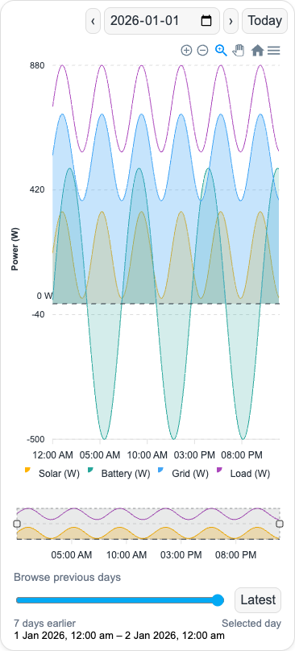

# Home Assistant Custom Cards

Reusable Home Assistant Lovelace cards and dashboard snippets for energy and smart-home projects.

## Solar Energy Flow Card

A date-selectable chart for solar, battery, grid, and load power history, with optional title, a dashed 0 W baseline, smooth areas, shared tooltips, zoom/export controls, and a brush overview. The ApexCharts engine is bundled locally; no separate chart installation is required. Install this repository as a HACS custom **Dashboard** repository. See the [installation guide and configuration options](cards/solar-energy-flow-card/README.md).

The installable file is `dist/solar-energy-flow-card.js`; editable source is under `cards/solar-energy-flow-card/`. Build it with `npm run build`. Optional energy summary tiles can use your cumulative helpers; see the [energy summary example](cards/solar-energy-flow-card/examples/energy-summary.yaml). Both the original `entities:` shorthand and the [ApexCharts-style example](cards/solar-energy-flow-card/examples/apexcharts-style.yaml) are supported.

Preview uses synthetic readings.

## Dashboard snippets

`dashboard-snippets/` contains generic examples for separately installed Button Card, ApexCharts Card, and Power Flow Card Plus. Replace the example sensor IDs in your private dashboard. The Solar Guardian style example has inverter-specific threshold and current-direction assumptions that you must adapt to your equipment.

Keep actual entity IDs, credentials, and private URLs in local Home Assistant configuration. This repository does not need Home Assistant tokens or connection details.
