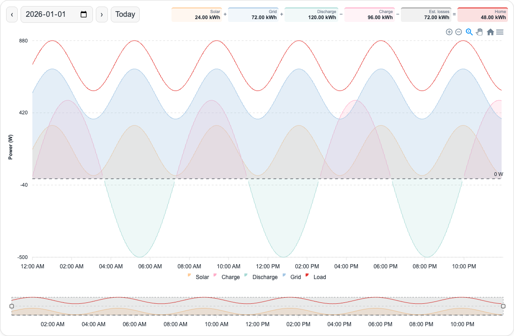

# Solar Energy Flow Card

Date-selectable Home Assistant Recorder history for solar, battery, grid, and load power. This card draws a power history chart and can summarize recorded cumulative energy helpers for the selected time range. It does not calculate source-to-load allocation.

## HACS installation

Publish this repository on GitHub, then add its URL in HACS → Custom repositories with type **Dashboard** (called **Lovelace** in some versions). Download **Solar Energy Flow Card**, reload the browser, and add the YAML below as a Manual card.

The root `hacs.json` selects `dist/solar-energy-flow-card.js`. The GitHub repository may be named `homeassistant-custom-cards`; the explicit `filename` selects the card. Without releases, HACS uses the default branch. If publishing releases, include the current JavaScript file as a release asset.

If HACS does not add the resource automatically, add `/hacsfiles/YOUR_REPOSITORY_NAME/solar-energy-flow-card.js` as a JavaScript module in dashboard resources, replacing `YOUR_REPOSITORY_NAME` with the actual GitHub repository name.

## Manual installation

Copy `dist/solar-energy-flow-card.js` to `/config/www/solar-energy-flow-card.js` and register `/local/solar-energy-flow-card.js` as a JavaScript module resource.

## Configuration

```yaml
type: custom:solar-energy-flow-card
title: Energy history
entities:
  solar: sensor.solar_power
  battery: sensor.battery_power
  grid: sensor.grid_power
  load: sensor.home_load_power
```

Replace the example IDs with your real IDs in your private Home Assistant dashboard configuration. Do not commit your local configuration here.

| Option | Required | Meaning |
| --- | --- | --- |
| `type` | Yes | `custom:solar-energy-flow-card` |
| `title` | No | Plain text heading; hidden when omitted or empty |
| `entities.solar` | Yes | Solar power sensor |
| `entities.battery` | Yes | Battery power sensor |
| `entities.grid` | Yes | Grid power sensor |
| `entities.load` | Yes | Load power sensor |

An omitted or empty `title` hides the heading. `header.show: false` hides it even when a title is supplied. `header.title` can also supply the title.

The default graph now matches the bundled ApexCharts example: smooth 1px lines, translucent solar/battery/grid areas, a red load line, five-minute averages with gaps, a shared tooltip, 12-hour labels, zoom/pan/reset/export, and a 100px solar/load brush overview. A dashed **0 W** baseline is always included, with its label on the right side of the graph. Your existing `entities:` configuration continues to work.

All four sensors must report numeric **watts**. Values are plotted as reported, including negative values; no sign or unit conversion is performed. `hours` was previously unused and remains ignored; the card always shows one calendar day.

Use the arrows, date field, and Today button to load a day. The day uses the browser's local timezone, which should match your intended Home Assistant timezone. Recorder and History must be enabled and retain the selected sensors. Unavailable or nonnumeric states become gaps. Five-minute buckets average numeric recorded samples; they are not time-weighted averages. Empty buckets remain gaps by default. No values are invented after the last sample when `extend_to: false`. This uses recent state history, not long-term statistics. Dates with no retained readings show an empty chart. To retry after an error, use a date control or Today. The chart refreshes on date selection, configuration, or page reload; it does not continuously poll live readings.

## Energy summary

Configure cumulative energy sensors to show compact totals in the top-right header beside the date controls. See the [full energy summary example](examples/energy-summary.yaml). The large tiles below the chart are removed. When solar, grid, battery charge/discharge, and home counters are configured, the compact boxes follow **Solar + Grid + Discharge − Charge − Est. losses = Home**. Home keeps its measured counter value. Estimated losses are the signed balance difference and include measurement/estimation error; a negative balance is flagged in its tooltip. Incomplete configurations show only the configured totals without equation operators.

Short labels keep the totals small; hover an item for its full description and any missing-data explanation; keyboard focus exposes the same information to assistive technology. On narrow cards the totals wrap below the date controls and the main plot shrinks by the same amount, keeping the card's overall height unchanged. On very narrow cards, scroll the equation sideways to see all terms.

```yaml
summary:
  show: true
  precision: 2
  entities:
    solar: sensor.solar_energy
    load: sensor.home_energy
    grid: sensor.grid_energy
    battery_charge: sensor.battery_charge_energy
    battery_discharge: sensor.battery_discharge_energy
```



These are **energy** helpers, not the graph's power sensors. Home Assistant Integral helpers are supported. Units are read from history attributes (or the current entity's attributes) and converted from Wh, kWh, or MWh into kWh. If needed, use an explicit unit for an individual helper:

```yaml
summary:
  entities:
    solar:
      entity: sensor.solar_energy
      unit: kWh
      mode: increasing
    grid:
      entity: sensor.grid_energy
      mode: net
```

Totals are the counter at the end of the selected range minus its value at the start, using the last recorded reading at or before each boundary. They are not lifetime totals and do not integrate the chart's grouped power samples. Changing the date, zoom, or mini graph selection updates the summaries. For today, the end is capped at the current time; values refresh when history is reloaded, like the main graph. Readings are not interpolated between counter updates, so boundary precision depends on helper update frequency. Integral helpers themselves estimate energy from power readings.

The `grid` label is **Grid energy**, and defaults to `net` mode: negative changes remain negative. Use optional `grid_import` and `grid_export` keys only when you have separate cumulative counters for those directions. One net helper cannot supply both import and export totals. Other keys default to `increasing` mode. `net` permits decreases; `increasing` reports a detected counter decrease as unavailable. Explicit changes to `last_reset` make either mode unavailable for that range. The card does not guess consumption across resets.

Missing history, unsupported units, unavailable boundary states, or detected resets display **—** with the explanation in the item tooltip and accessible label, rather than zero. A stable recorded counter can correctly show 0.00 kWh. Recorder must retain the energy helpers as well as the power sensors. Newly created helpers cannot backfill energy history from before they existed; the card does not use long-term statistics. An energy-history request failure leaves the power chart working.

| Option | Default | Meaning |
| --- | --- | --- |
| `summary.show` | Enabled when entities are configured | Show the energy summary; `false` disables its history request and compact totals |
| `summary.precision` | `2` | Decimal places in kWh, from 0 to 6 |
| `summary.entities` | None | Any of `solar`, `load`, `grid`, `grid_import`, `grid_export`, `battery_charge`, `battery_discharge`, mapped to a sensor ID or object |
| Per-helper `entity` | Required for object syntax | Cumulative energy sensor ID |
| Per-helper `unit` | Auto-detected | Explicit Wh, kWh, or MWh override |
| Per-helper `mode` | `net` for `grid`, otherwise `increasing` | Whether decreases represent net energy or an invalid/reset counter |

## ApexCharts-style configuration

See [the full example](examples/apexcharts-style.yaml). You may copy the settings from `dashboard-snippets/apexcharts-card.yaml`, change `type` to `custom:solar-energy-flow-card`, and retain its `series:` list. Use your real sensor IDs privately. A `series:` list takes precedence over `entities:`. This card bundles the ApexCharts engine, so the separate ApexCharts Card is not required.

```yaml
type: custom:solar-energy-flow-card
header:
  show: false
hours_12: true
experimental:
  brush: true
brush:
  selection_span: 24h
  apex_config:
    chart:
      height: 100
all_series_config:
  stroke_width: 1
  curve: smooth
  float_precision: 0
  extend_to: false
  group_by:
    func: avg
    duration: 5min
    fill: "null"
apex_config:
  chart:
    height: 550
  legend:
    position: bottom
  tooltip:
    shared: true
series:
  - entity: sensor.solar_power
    name: Solar (W)
    color: "#ffb300"
    type: area
    opacity: 0.25
    show:
      in_brush: true
  - entity: sensor.battery_power
    name: Battery (W)
    color: "#26a69a"
    type: area
    opacity: 0.2
  - entity: sensor.grid_power
    name: Grid (W)
    color: "#42a5f5"
    type: area
    opacity: 0.3
  - entity: sensor.home_load_power
    name: Load (W)
    color: "#ab47bc"
    type: line
    show:
      in_brush: true
```

### Card options

| Option | Default | Meaning |
| --- | --- | --- |
| `header.show` | Title present | Show the optional heading; date controls stay visible |
| `header.title` | `title` or empty | Plain text heading |
| `graph_span` | `1d` | Time range starting at the selected day's midnight, up to `7d`; `1d`/`24h` respect calendar-day DST |
| `span.start` | `day` | Only `day` is supported; use the date selector to choose the day |
| `hours_12` | `true` | 12-hour time labels and tooltips; set `false` for 24-hour time |
| `stacked` | `false` | Stack the plotted series |
| `cache` | `false` | Reuse up to eight history responses for 30 seconds when enabled |
| `experimental.brush` | `true` | Show the range-selection overview |
| `brush.selection_span` | Entire range | Initial brush selection, e.g. `6h` or `24h` |
| `brush.apex_config` | 100px height | ApexCharts options for the overview |
| `apex_config` | See defaults above | ApexCharts 3.54.1 options for the main chart, including height, toolbar, legend, y-axis, annotations, tooltip, and grid |
| `series` | Four `entities` series | One to 24 series definitions |
| `all_series_config` | Defaults below | Shared series settings, overridden by each series |
| `section_mode`, `grid_options` | Home Assistant layout | Retained for dashboard layout; this card reports a default 24-column / 11-row section size |

Durations accept positive numbers with `ms`, `s`/`sec`, `m`/`min`, `h`/`hr`, or `d`/`day`. At most 10,000 grouping buckets per series are allowed.

### Series options

| Option | Default | Meaning |
| --- | --- | --- |
| `entity` | Required | A `sensor.*` entity reporting watts |
| `name` | Entity ID | Legend and tooltip label |
| `color` | Solar/battery/grid/load palette | Three- or six-digit hex color |
| `type` | `line` | `line` or `area` |
| `opacity` | `0.2` | Area opacity from 0 to 1; `entities` defaults use 0.25 / 0.2 / 0.3 |
| `stroke_width` | `1` | Line width from 0 to 10 |
| `direction` | `both` | `both`, `positive`, or `negative`; mask the opposite sign after grouping without changing values |
| `curve` | `smooth` | `smooth`, `straight`, or `stepline` |
| `float_precision` | `0` | Tooltip decimal places, 0 to 10 |
| `extend_to` | `false` | No extension; `now` extends to current time (capped at range end), `end` extends to range end |
| `group_by.func` | `avg` | `avg`, `min`, `max`, `sum`, `first`, `last`, `diff`, `median`, or `raw` |
| `group_by.duration` | `5min` | Bucket duration, aligned to the selected day's midnight |
| `group_by.fill` | `"null"` | Empty buckets: `"null"`, `zero`, or `last`; quote `"null"` in YAML |
| `show.in_brush` | `false` for explicit series | Include in the overview; if none are selected, show all series |

For `entities:` shorthand, the solar and load series appear in the brush. Battery power is split into positive charging (pink) and negative discharging (teal) series. If your inverter uses the opposite sign convention, use explicit `series:` with the appropriate directions. The palette is solar orange `#ffcc99`, grid blue `#a6c8e5`, battery discharge teal `#a8dad5`, battery charge pink `#ffafca`, and home red `#e53935`. The summary boxes use the same palette. Existing explicit series colors remain configurable; use the updated example YAML for the matching colors and split battery series. `raw` preserves recorded timestamps and null gaps without bucketing or extension; shared tooltips work best with aligned bucketed data.

This implements the options used by the included example, not the entire separate ApexCharts Card API: transforms, data generators, statistics, arbitrary span offsets, and action handlers are not supported. Raw `apex_config` cannot replace the card's series, datetime bounds, chart IDs, brush target/selection, or required zero annotation. JavaScript strings are never evaluated. Explicit y-axis min/max options can clip data or the zero line; omit them for automatic bounds that include zero.

## Development

The editable card is under `cards/solar-energy-flow-card/`. The pinned MIT-licensed engine is in its `vendor/` folder; see [third-party notices](../../THIRD_PARTY_NOTICES.md). The build wraps both in one private scope and makes a self-contained HACS file. There are no CDN requests or runtime dependencies to install.

```sh
npm ci
npm run build
node --check cards/solar-energy-flow-card/solar-energy-flow-card.js
node --check dist/solar-energy-flow-card.js
npm test
TZ=America/New_York npm test
npx playwright install chromium
npm run test:browser
ruby -ryaml -e 'Dir["**/*.yaml"].each { |path| YAML.load_file(path) }'
```

CI checks the distribution, JavaScript, YAML, regression tests, Chrome rendering/interactions, and HACS metadata. Browser fixtures use synthetic history; a live Home Assistant test is still needed before a release.
